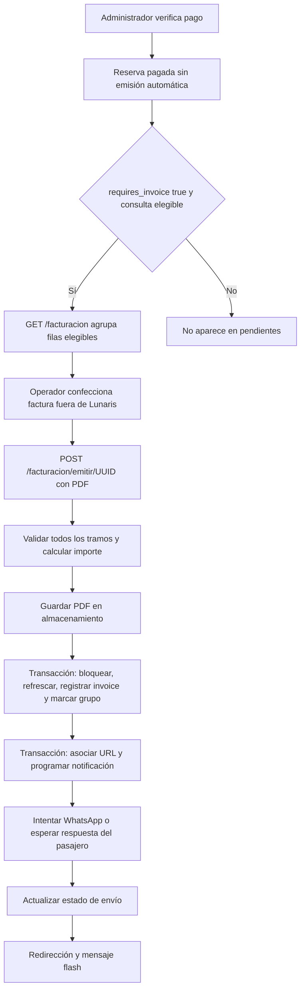

# Auditoría técnica del circuito de facturación

Fecha: 14/10/2026. Código inspeccionado: commit `75d7d70`, más el estado local del workspace. Primera fase exclusivamente de auditoría. No se modificó código productivo, no se consultó ni modificó PostgreSQL productivo, no se ejecutó Flyway, no se emitieron comprobantes ni se enviaron mensajes reales. Se agregaron pruebas locales de caracterización. Existía un test de webhook sin seguimiento antes de esta auditoría; se conserva.

## 1. Diagnóstico ejecutivo y límites

**El circuito esperado de aprobación → generación fiscal → PDF no existe en este módulo.** El circuito implementado es confección externa del comprobante → carga manual del PDF → registro interno → WhatsApp. Lo declaran tanto la entidad `Invoice` como la migración V32 y la pantalla. No hay una operación de aprobación fiscal separada en el frontend inspeccionado: el botón es «Enviar» y exige adjuntar un archivo.

**La consulta de pendientes excluye reservas con `requires_invoice = false`. El endpoint de registro no las rechaza por ese motivo.** Con los valores comunicados para el grupo de producción, ambas reservas quedarían fuera de la pantalla en esta versión. El pago verificado no genera automáticamente un registro en `invoices`.

Esto explica la falta de visibilidad y la discrepancia funcional, pero **no demuestra qué ocurrió en el clic reportado en producción**. Sin versión desplegada, petición HTTP, respuesta, logs y evidencia de carga del PDF, no se puede atribuir ese incidente a una excepción concreta. Los estados y la ausencia de facturas en producción son evidencia aportada por el solicitante, no observaciones realizadas durante esta auditoría.

No se encontró integración ARCA/AFIP, WSAA, WSFE, cliente de autorización, generación de CAE ni generación de PDF dentro del circuito inspeccionado. `authorization_code` existe desde V128 y en la entidad, pero no se asigna en el flujo. El número `F-año-contador` es una referencia interna, no evidencia de autorización fiscal. No se evaluó cumplimiento tributario del comprobante externo ni se infirió su validez.

## 2. Mapa del flujo real



### Pago

`MarkTripAsPaidService.markTripAsPaid` bloquea el grupo, valida que sea especial y no cancelado/vencido, marca `payment_verified`, `payment_status`, fecha y `CONFIRMED`; guarda eventos `PAYMENT_VERIFIED`. No llama a facturación y no cambia `requires_invoice`. Hay otros flujos de pago (`ConfirmPaymentUseCase`, actualizaciones en `ReservationService`), por lo que el código de reserva por sí solo no identifica el endpoint usado.

Los endpoints identificados son `POST /api/admin/trips/{id}/paid` (`ManualTripApiController`, línea 31) para especiales y `POST /api/agenda/confirmar-pago/{id}` (`AgendaViewController`, línea 412) para confirmación desde agenda. Ambos corresponden a pago, no a registro del PDF.

La entidad `Reservation`, en `@PrePersist/@PreUpdate`, deriva `payment_status` de `payment_verified`. Esto mantiene coherencia en escrituras ORM habituales, pero el endpoint de facturación no compara explícitamente `payment_status` con `PAID`.

### Frontend administrativo

`GET /facturacion` renderiza Thymeleaf con `GetBillingPanelUseCase.execute()`; no hay fetch AJAX para emitir. `findPendingInvoiceReservations()` exige:

- `payment_verified = true`;
- `requires_invoice = true`;
- estado distinto de `CANCELLED` y `REJECTED`, normalizado a mayúsculas;
- ausencia de factura directa y ausencia de factura vinculada a un tramo/grupo relacionado.

No filtra `payment_status` ni `invoice_issued`. Tampoco exige `status = CONFIRMED`, a diferencia de emisión. Un `EXPIRED`, un estado no canónico o un grupo parcialmente pagado puede aparecer y luego ser rechazado.

Agrupa **sólo las filas ya filtradas**, no recupera todo el grupo para calcular la vista. Si un tramo tiene `requires_invoice = false` o pago no verificado, la pantalla puede mostrar un importe parcial; `issue()` vuelve a obtener el grupo completo y factura otro importe o rechaza la operación.

El formulario envía `multipart/form-data` a `POST /facturacion/emitir/{reservationId}`, con el archivo `pdf` y campos de seguridad que pueda incorporar el procesador de formularios. No envía importe, CAE, número fiscal, aprobación ni clave de idempotencia. `accept="application/pdf"` y `required` son restricciones del navegador; el backend sólo comprueba que el archivo no esté vacío.

El controlador responde con redirección a `/facturacion`; éxito y error se comunican por flash attributes. La redirección por sí sola no significa emisión exitosa. No hay eliminación optimista de filas. La fila desaparece por la consulta de DB cuando ya existe un registro, aun si WhatsApp falló. Eso corresponde a pasarla al historial, pero no existe un estado formal de emisión fallida.

No se muestra éxito antes de volver de `issue()`. Sin embargo, los textos «emitida» y «enviada» sobrestiman el resultado: sólo se registró un PDF externo y, en el segundo caso, se aceptó un envío por la API, sin demostrar entrega al destinatario.

### Backend, persistencia y notificación

1. `IssueInvoiceUseCase.issue()` obtiene la reserva y el grupo por `booking_group_code` o sufijos `-IDA/-VUELTA`.
2. Exige que **todos** los tramos tengan pago verificado y estado exactamente `CONFIRMED`; exige total positivo. No exige `requires_invoice`, ni rechaza `invoice_issued`.
3. Elige el tramo `-IDA`; si no existe, usa la reserva solicitada. Reutiliza su número interno si existe; de lo contrario usa `invoiceRepository.count() + 1`.
4. Guarda el PDF **antes** de la transacción de persistencia.
5. `InvoicePersistenceService.persistUploadedInvoice()` bloquea reservas en orden y refresca entidades para evitar estados obsoletos de OpenEntityManagerInView. Revalida pago/estado. Para grupos con viajes especiales, compara el importe con el cálculo actualizado; para regulares no realiza esa comparación.
6. Bloquea la factura por `reservation_id`, crea o actualiza una fila, persiste y hace flush si es nueva. Marca `invoice_issued = true` en todos los tramos dentro de la misma transacción. La factura se relaciona con una sola reserva; no hay tabla invoice-reservations ni clave fiscal de grupo.
7. La escritura de `Invoice` y las marcas del grupo se confirman juntas en el flujo web normal, antes de notificar. No hay transacción distribuida con almacenamiento ni WhatsApp.
8. `invoiceReady()` asocia `invoice_url` a los tramos y marca notificación pendiente en otra transacción. Intenta enviar texto/documento dentro de la ventana de conversación o una plantilla y espera respuesta. Hay reintento programado y reacción a mensajes del pasajero.
9. `complete()` marca envío de invoice después del documento. `issue()` vuelve a escribir el estado en otra transacción. Si falla ese último paso, el controlador informa error aunque la factura ya esté registrada.

`sendByWhatsApp()` captura excepciones y devuelve false; por diseño un fallo de notificación no deshace la factura. El controlador captura excepciones generales y expone `e.getMessage()` en pantalla; esto aporta diagnóstico puntual, pero no registra un intento fallido estructurado y puede divulgar detalles internos. Una petición sin parte `pdf`, un rechazo de seguridad o un multipart demasiado grande puede fallar antes de entrar en el método y no recibir su flash específico.

### ARCA y PDF

No hay proveedor fiscal dentro de esta cadena. Por eso autenticación fiscal, CAE, consulta de comprobantes autorizados, reintentos fiscales y recuperación tras timeout fiscal no tienen implementación que auditar aquí. Tampoco hay generador de PDF: sólo `InvoiceStoragePort.store/load`. No corresponde simular un proveedor inexistente y presentar ese test como validación de ARCA.

Cloudinary es el almacenamiento principal; producción exige configuración. En otros perfiles puede usar disco local. Cloudinary sube recursos `raw`, públicos y con `overwrite=true`. La descarga tiene timeouts y recuperación mediante URL firmada ante 401/403. No se observó recuperación de registro ante timeout ambiguo de subida. El endpoint público `/public/invoices/{invoiceId}.pdf` permite descargar por UUID sin autenticación; la URL y los objetos públicos requieren cuidado porque contienen información personal y fiscal.

## 3. Importes y reservas agrupadas

`BookingInvoiceAmount.total()` define el importe compartido:

- Si todos los tramos tienen `amount_is_group_total = false`: suma `amount` de cada tramo.
- Si todos tienen `amount_is_group_total = true`: toma una sola vez el importe común; rechaza valores diferentes y mezclas de alcances.
- Siempre suma `extra_amount` de cada tramo.
- No multiplica por `passenger_count`; no toma `custom_price`; no resta `discount_amount` ni agrega `used_balance`.

En el alta especial, `Reservation.prepareSpecialTripCreation()` trata `custom_price` como precio por persona de todo el recorrido: calcula `amount = custom_price * passenger_count`; `ReservationService` reparte el total entre tramos. El comentario del campo `customPrice` que lo describe como precio total del grupo contradice esa implementación. Los datos comunicados son compatibles con 79.000 × 2 / 2 = 79.000 por tramo si provinieron de ese alta, sin que esto demuestre su historia comercial.

Los flujos regulares pueden aplicar saldo y reducir `amount`/extras; los descuentos se conservan como información y los tests existentes esperan importe neto más extras sin restar el descuento otra vez. Facturación reproduce el monto almacenado pendiente/cobrado, no necesariamente el valor bruto del servicio. En particular, saldo que cubre todo reduce el importe a cero y este circuito no registra factura. La decisión fiscal sobre saldos y bonificaciones requiere confirmación comercial/contable; no se recomienda alterar la fórmula durante esta fase.

Para el grupo comunicado: **total calculado = 158.000 + suma de extras**. Si ambos extras son cero/nulos, resulta 158.000. La diferencia hasta 170.000 es 12.000; podría corresponder a extras, ajuste acordado o información histórica, pero no existe evidencia que elija una explicación. Se necesitan extras, descuentos, saldo aplicado, categoría del viaje, eventos y comprobante externo. No se declara 158.000 como importe fiscal correcto.

Se registra normalmente una factura por grupo, enlazada a IDA, y se marcan todos los tramos. No hay garantía estructural de unicidad por grupo: V120 sólo impone unicidad por `reservation_id`. Sin IDA, el fallback depende de la reserva solicitada; además `persistUploadedInvoice()` acepta cualquier tramo. Dos IDs del mismo grupo pueden producir dos filas distintas. La consulta de pendientes oculta el grupo al encontrar cualquiera de ellas, sin mostrar esa inconsistencia.

## 4. Causa raíz: hechos e hipótesis

### Hechos comprobados

1. No hay generación fiscal automática ni aprobación fiscal implementada en la pantalla auditada; se necesita un PDF externo.
2. El pago verificado no equivale a autorización de facturación.
3. `requires_invoice = false` excluye de pendientes, pero no impide una carga explícita al endpoint cuando el grupo está confirmado y pagado.
4. Fallar antes/durante persistencia puede dejar cero filas en `invoices`. Fallar sólo en WhatsApp no explica cero filas en el flujo web normal.
5. Falla de DB posterior a subir PDF puede dejar un documento sin registro. Falla posterior a guardar puede producir mensaje de error con registro existente.

### Hipótesis pendientes sobre el incidente

- Se verificó pago desde agenda y se interpretó como aprobación de factura.
- La versión desplegada tiene otro frontend/backend o todavía no contiene estas clases/migraciones.
- No se adjuntó PDF, el POST no llegó, falló seguridad/multipart o hubo error de almacenamiento/persistencia.
- Se buscó factura sólo por un tramo, otro esquema/DB o una asociación diferente.

Para resolverlo: correlacionar la franja horaria reportada con zona horaria explícita, commit desplegado, ruta y UUID del POST, estado HTTP y flash, logs sin datos personales, existencia del objeto PDF y todas las asociaciones del grupo en `invoices`. Consultar también historial Flyway **sólo en lectura** para comprobar V120, V128 y V133. No activar ni corregir estados manualmente durante el diagnóstico. Se preparó `docs/auditoria-facturacion-consultas.sql`, con transacción de sólo lectura y resultados sin datos personales completos; no fue ejecutado.

Los otros dos casos, identificados aquí como A y L para no repetir datos personales: con pago pendiente ninguno cumple el filtro aunque A solicite factura. L además no la solicita. Estar `CONFIRMED` no demuestra estar pagado. Estos estados por sí solos no son anomalías de facturación.

## 5. Riesgos por severidad

| Severidad | Hallazgo | Consecuencia |
|---|---|---|
| CRITICAL | `count()+1` sin secuencia ni unicidad de número, nombre de archivo derivado del número y sobrescritura | Dos grupos simultáneos pueden recibir el mismo número y sobrescribir el PDF; también puede ocurrir después de borrar filas. Riesgo demostrado por la construcción del código; no observado en producción. |
| HIGH | Unidad de unicidad es reserva, no grupo; fallback variable sin IDA | Duplicación grupal; el bloqueo serializa pero no impide crear una fila para cada ID. |
| HIGH | Vista calcula sobre subconjunto; emisión usa grupo completo | Operador puede adjuntar un documento por importe diferente del registrado. |
| HIGH | No hay intento administrativo persistente, estados de error ni referencia fiscal obligatoria | Una aprobación reportada no es trazable; número interno y bandera no prueban autorización. |
| HIGH | Subida previa a DB y re-subida mutable | PDF huérfano, sustitución de documento de factura ya registrada o sustitución aun cuando después falle la DB. |
| HIGH | No hay validación server-side de contenido PDF, número fiscal, CAE, importe del documento ni receptor | Archivo arbitrario o comprobante equivocado puede registrarse como factura. |
| MEDIUM | Estado/alcance de pago de la consulta difieren de las validaciones de emisión | Filas ofrecidas que no se pueden registrar; errores de grupo parcial. |
| MEDIUM | Doble actualización de estado de notificación y ausencia de ID de mensaje/confirmación de entrega | Carrera entre callback y actualización final; envío aceptado no prueba entrega; timeout puede duplicar mensajes. |
| MEDIUM | Marca `invoice_issued` no gobierna pendientes; no hay reconciliación de banderas/URLs | Estados inconsistentes pueden pasar inadvertidos. |
| MEDIUM | Objetos Cloudinary públicos y enlace por UUID sin vencimiento | Exposición de documentos si se comparte o filtra una URL. |
| MEDIUM | `e.getMessage()` en UI y excepciones generales | Diagnóstico sin estado durable; potencial filtración de detalles técnicos. |
| LOW | «Emitida», «Sin enviar» y «falló» no distinguen registro externo/espera de respuesta/entrega | Interpretación operativa incorrecta. |
| LOW | Historial completo sin paginación; lectura PDF remota dentro de transacción | Crecimiento de carga y conexiones retenidas en descargas lentas. |

La carrera de entrega es plausible: `invoiceReady()` lee un booleano, un callback posterior puede guardar éxito y `updateDeliveryStatus(false)` puede pisarlo. Una recarga resetea envío; el callback de un intento previo puede seguir afectando el mismo registro. No se afirma que haya ocurrido en el incidente.

## 6. Consistencia de datos

| Estado | Evaluación del código |
|---|---|
| Pago verificado sin factura | Válido entre acciones; puede quedar invisible por `requires_invoice=false`. |
| Factura fiscal externa sin fila | Posible: el sistema no participa de su emisión. |
| PDF subido sin fila | Posible si falla persistencia después de almacenamiento. |
| `invoice_issued=true` sin factura | No lo produce el éxito normal de la transacción; DB no exige asociación. Requiere reconciliación. |
| Invoice con `invoice_issued=false` | Normalmente se actualizan juntos; datos históricos, otros escritores o rollbacks externos deben investigarse. |
| Invoice sin PDF válido | La URL puede existir aunque el contenido sea inválido, inaccesible o posteriormente reemplazado. |
| Invoice sin envío | Contemplado con reenvío; espera por ventana también aparece como «Sin enviar». |
| Duplicado por reintento | Una misma reserva tiene protección V120 si aplicada; el documento y la notificación se repiten y el grupo no tiene unicidad propia. |
| Canceladas en pendientes | `CANCELLED/REJECTED` excluidas; emisión rechaza cualquier estado distinto de `CONFIRMED`. Variantes y grupos mixtos exigen diagnóstico. |

V120 elimina facturas duplicadas antes de crear el índice, conservando la más reciente. No ejecutarla como reparación sin inventario y respaldo de referencias/documentos; no se ejecutó durante esta auditoría. `Optional` no evita por sí solo resultados múltiples: la garantía depende del índice aplicado.

## 7. Archivos y referencias relevantes

Rutas relativas al repositorio; líneas del código auditado:

| Archivo | Referencia |
|---|---|
| `src/main/resources/templates/facturacion.html` | 55: explicación del proceso externo; 98: formulario multipart; 139: historial; 168: reenvío |
| `src/main/java/com/lunaris/ansenuza/infrastructure/web/controller/BillingViewController.java` | 35: GET panel; 54: POST emitir; 80: POST reenviar; errores y flash |
| `src/main/java/com/lunaris/ansenuza/application/usecase/GetBillingPanelUseCase.java` | 29: execute; 77: consolidación; 94: fila; 131: total |
| `src/main/java/com/lunaris/ansenuza/domain/repository/ReservationRepository.java` | 23: clave grupal; 136: consulta grupo; 151: bloqueo grupal; 359: pendientes; 386: ingresos |
| `src/main/java/com/lunaris/ansenuza/application/usecase/IssueInvoiceUseCase.java` | 50: issue; 84: retry de integridad; 95: resend; 111: download; 138: numeración; 150: primaria |
| `src/main/java/com/lunaris/ansenuza/application/usecase/InvoicePersistenceService.java` | 33: persistUploadedInvoice; 45: refresh; 71: persist/flush; 74: marca grupal; 79: entrega |
| `src/main/java/com/lunaris/ansenuza/domain/model/service/BookingInvoiceAmount.java` | 12: clave; 20: cálculo |
| `src/main/java/com/lunaris/ansenuza/domain/model/Invoice.java` | 23: contrato externo; 34: UUID; 47: authorizationCode; 79: fallback |
| `src/main/java/com/lunaris/ansenuza/domain/model/Reservation.java` | 113: customPrice; 235: requiresInvoice; 238: coherencia pago; 298: alta especial; 323: precio × pasajeros |
| `src/main/java/com/lunaris/ansenuza/domain/repository/InvoiceRepository.java` | 19: consultas por reserva; 23: bloqueo; 34: historial |
| `src/main/java/com/lunaris/ansenuza/application/usecase/MarkTripAsPaidService.java` | 27: pago especial; 50: evento |
| `src/main/java/com/lunaris/ansenuza/application/usecase/ConfirmPaymentUseCase.java` | confirmación de pago regular, sin emisión |
| `src/main/java/com/lunaris/ansenuza/domain/model/service/ReservationService.java` | 219: saldo; 250: distribución por tramos; 314: importe de vuelta |
| `src/main/java/com/lunaris/ansenuza/application/usecase/ManualReservationNotificationService.java` | 71: retry; 79: invoiceReady; 97: deliver; 123: dispatch; 148: complete |
| `src/main/java/com/lunaris/ansenuza/infrastructure/storage/CloudinaryInvoiceStorageService.java` | 94: store; subida pública/sobrescritura; 134: load |
| `src/main/java/com/lunaris/ansenuza/infrastructure/storage/LocalInvoiceStorageService.java` | 27: store; 47: load |
| `src/main/java/com/lunaris/ansenuza/infrastructure/web/controller/PublicInvoiceController.java` | 20: descarga pública |
| `src/main/java/com/lunaris/ansenuza/infrastructure/config/SecurityConfig.java` | 125: descarga pública; 143: ADMIN/FACTURACION |
| `src/main/java/com/lunaris/ansenuza/infrastructure/whatsapp/WhatsAppService.java` | 417: documento; 450: diferimiento afterCommit; 470: callback |
| `src/main/resources/db/migration/V32__create_invoices_and_payment_timestamp.sql` | creación invoice/FK y contrato PDF externo |
| `src/main/resources/db/migration/V37__add_requires_invoice_to_reservations.sql` | default DB false, diferente del default actual de entidad true |
| `src/main/resources/db/migration/V115__extend_invoice_pdf_url.sql` | ampliación URL |
| `src/main/resources/db/migration/V120__enforce_single_invoice_per_reservation.sql` | limpieza de duplicados e índice único por reserva |
| `src/main/resources/db/migration/V126__reservation_amount_scope.sql` | alcance amount |
| `src/main/resources/db/migration/V128__manual_reservation_notifications.sql` | notificaciones y authorization_code |
| `src/main/resources/db/migration/V133__special_agenda_trips_and_payment_status.sql` | payment_status, invoice_issued, backfill y checks |

## 8. Reproducción y regresión

Se agregaron `BillingAuditCharacterizationTest` (mocks, sin Spring/red) y `BillingAuditPersistenceTest` (H2 efímera, Flyway desactivado). Son pruebas del comportamiento actual, incluso de defectos; deberán invertirse o ajustarse al corregirlos. No deben interpretarse como contrato deseado.

| Escenario obligatorio | Prueba/evidencia |
|---|---|
| 1. Pago verificado y carga aprobada | Tests existentes de issue y `ManualReservationIntegrationTest`: carga, registro y marcas. |
| 2. requires_invoice=false | Nueva prueba H2: grupo invisible; nueva prueba de use case: carga permitida. |
| 3. Pago pendiente | Nueva prueba: rechazo antes de subir; integración existente también valida persistencia. |
| 4. Cancelada | Nueva prueba: rechazo antes de almacenamiento. |
| 5. Ida/vuelta | Nueva prueba: dos importes de 79.000 resultan 158.000, no se multiplican por pasajeros; pruebas existentes de total repetido, descuento y extras. |
| 6. Ya emitida | Nueva prueba: vuelve a subir; prueba existente confirma actualización de una misma fila. |
| 7. Fallo fiscal | No aplicable al código: proveedor fiscal inexistente. Requerirá stub y pruebas propias si se integra. |
| 8. Fallo de DB | Nueva prueba: error después de subir, sin notificar. No prueba rollback PostgreSQL real; se requiere integración adicional. |
| 9. Fallo de PDF | No existe generación; nueva prueba de almacenamiento fallido impide registro. Tests Cloudinary existentes cubren carga/descarga. |
| 10. Fallo WhatsApp | Nueva prueba: registro conservado y sin enviar; integración existente cubre espera de plantilla/reply y documento fallido. |
| 11. Simultáneas | Nueva prueba con barrera: ambas suben antes de persistencia. No demuestra locking PostgreSQL; añadir prueba con dos transacciones reales en DB desechable. |
| 12. Reintento timeout | Nueva prueba: timeout de almacenamiento seguido de retry repite subida. Timeout fiscal no aplicable. |

También se agregó reproducción H2 de importe parcial de pantalla y de dos registros por IDs diferentes de un mismo grupo. El segundo caso prueba el límite del servicio de persistencia, no que todo grupo con IDA pueda duplicarse desde el endpoint normal.

Regresión adicional recomendada: numeración concurrente entre grupos distintos y verificación de identidad del PDF; grupo sin IDA; grupo mixto pagado/pendiente y cancelled; rechazo sin escritura para aprobación no elegible; reenvío sin cambiar importe/archivo/número; callback tardío que no borre éxito; caída entre commit y scheduling; archivo inválido; reintento después de timeout ambiguo; reconciliación de bandera y asociación; conservación del comprobante externo al fallar DB.

### Ejecución segura

Se ejecutó `./mvnw test` con variables de pruebas PostgreSQL removidas, perfil test, datasource H2 y `spring.flyway.enabled=false`. Las pruebas de PostgreSQL condicionadas por variables quedaron omitidas. La suite utiliza mocks para integraciones; no se inició el backend productivo.

**Resultado final: BUILD SUCCESS; 774 pruebas, 0 fallos, 0 errores, 13 omitidas.** Finalizó el 14/10/2026 a las 15:44:30 -03:00. Las 14 pruebas nuevas pasaron (11 con mocks y 3 con H2). La primera ejecución previa a agregarlas pasó con 760 pruebas. Una ejecución intermedia detectó un problema del fixture H2 al consultar con el mismo contexto de persistencia; se corrigió con flush/clear para representar la redirección web y se repitió toda la suite con éxito. No se modificó producción para resolverlo.

```bash
env -u INTERURBAN_TEST_JDBC_URL -u CHATBOT_ANALYTICS_TEST_PG_URL -u VERIFY_PASSWORD_HASH \
  ./mvnw test -Dspring.flyway.enabled=false \
  -Dspring.datasource.url=jdbc:h2:mem:audit-safe \
  -Dspring.datasource.username=sa -Dspring.datasource.password= \
  -Dspring.profiles.active=test
```

## 9. Corrección mínima recomendada

1. Mantener separadas verificación de pago y autorización/registro de factura. No cambiar el significado de `requires_invoice` ni convertir pago verificado en emisión automática.
2. Acordar el contrato operativo: conservar registro de factura externa como solución mínima, con textos «Registrar PDF» y estado explícito; una generación ARCA automática constituye otro alcance, no un arreglo de esta pantalla.
3. Mostrar operaciones pagadas sin solicitud en una sección explícita de revisión, con acción administrativa de aprobación trazable. La autorización debe quedar registrada independientemente de la preferencia del pasajero. Esto requiere decisión funcional, no sobrescribir `requires_invoice` silenciosamente.
4. Usar un único resolvedor de grupo completo y validador para vista y escritura. Registrar snapshot del importe y sus componentes antes de aprobar, y verificar cambios bajo bloqueo para todos los tipos de viaje.
5. Asignar identidad estable de operación/grupo; impedir duplicados con restricción DB de esa identidad. Sustituir `count()+1` por secuencia para referencia interna; usar UUID como clave inmutable del archivo. No usar número interno como número fiscal.
6. Conservar número fiscal externo, punto de venta/tipo, referencia de autorización cuando corresponda y hash del PDF; validar contenido y metadatos. Mantener documento inmutable; una sustitución exige acción diferenciada y auditada.
7. Persistir intento con actor, clave idempotente, timestamps, estado y código de error sanitizado. Estados mínimos: aprobado, documento pendiente, registrado, notificación pendiente, enviado/aceptado y fallido recuperable. Los estados fiscales sólo deben existir cuando haya integración fiscal real.
8. Recuperar almacenamiento y notificación sin crear otra factura. Usar outbox o tarea durable en la transacción de registro; resolver callbacks por ID de intento para no pisar resultados posteriores. No mantener transacción de DB durante llamadas de red.
9. Retornar resultado verificable: invoiceId, referencia, estado y error específico. Distinguir espera de respuesta de fallo. No interpretar redirección o HTTP 2xx como autorización fiscal.

Si se autoriza ARCA posteriormente, introducir un puerto fiscal y adaptador de homologación: autenticar, autorizar, persistir CAE/referencia, y consultar autorización previa ante timeout ambiguo antes de reintentar. Generación/archivo PDF y WhatsApp serán pasos recuperables posteriores. La especificación fiscal deberá validarse con documentación oficial vigente antes de implementar; esta auditoría no inventa esos contratos.

## 10. Plan de implementación sin interrupción

1. Cerrar evidencia del incidente mediante observación de sólo lectura y verificar correspondencia con el commit desplegado.
2. Acordar con operación/contabilidad importe, saldo, extras y responsabilidad de confección fiscal. No corregir 158.000 a 170.000 sin esa evidencia.
3. Aprobar cambios mínimos y criterios de aceptación; conservar el flujo externo durante la transición.
4. Inventariar duplicados/banderas/archivos y respaldar referencias. Diseñar migraciones aditivas e idempotencia grupal; no borrar históricos como solución inicial.
5. Corregir resolvedor, numeración/archivo inmutable, validaciones y trazabilidad. Validar en H2 y PostgreSQL desechable con restricciones reales y concurrencia.
6. Introducir tarea durable para notificación/almacenamiento y reconciliación observable, con rollout gradual y bandera de funcionalidad.
7. Desplegar primero cambios compatibles de datos y luego aplicación; probar registro externo con integraciones simuladas en staging y monitorear tasas de éxito/fallos y duplicados.
8. Recuperar intentos fallidos conservando comprobante y referencia. Reconciliar históricos mediante procedimiento revisable, separado del despliegue.
9. Implementar ARCA sólo si se autoriza ese alcance, inicialmente en homologación, y sin activar producción durante pruebas.

No se implementó ninguna de estas propuestas durante la auditoría.
